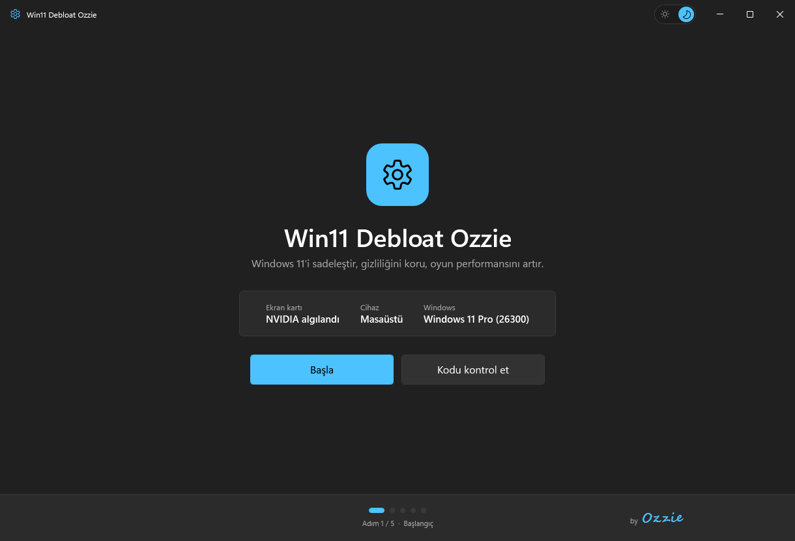
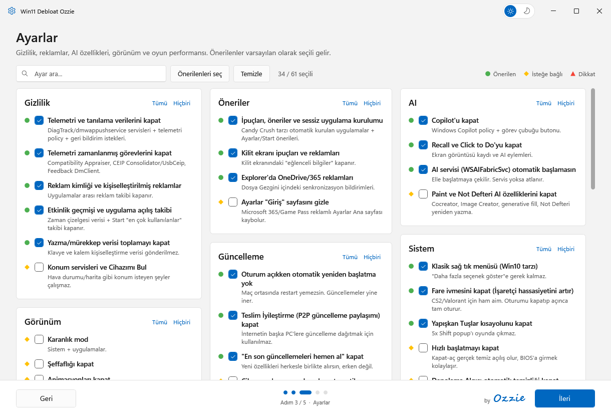
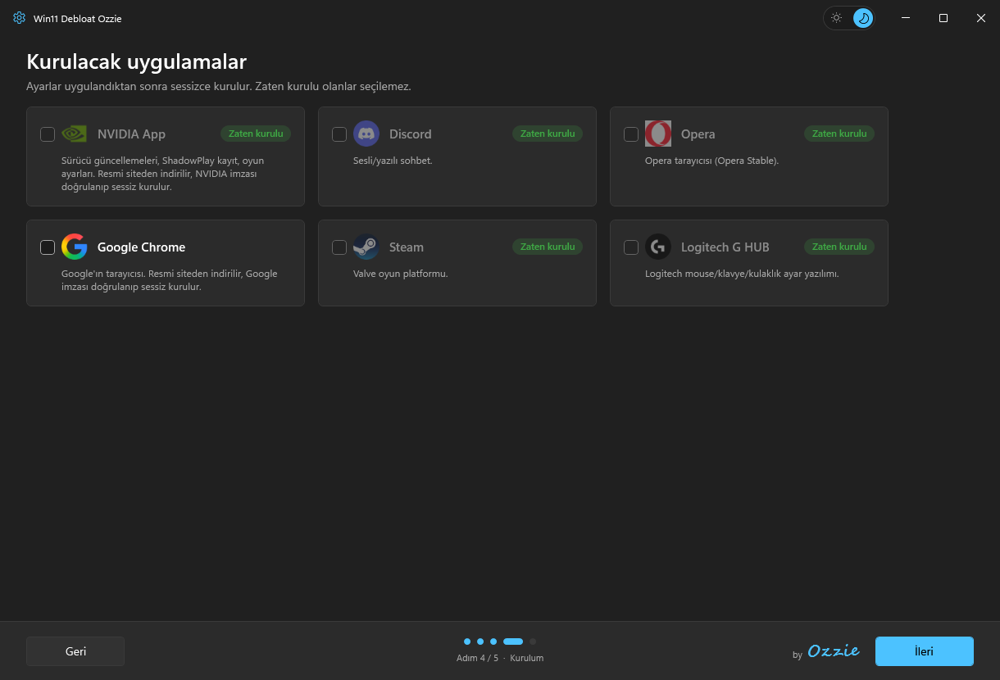

<div align="center">

# Win11 Debloat Ozzie

**Windows 11'i sadeleştir, gizliliğini koru, oyun performansını artır.**
**Clean up Windows 11, protect your privacy, boost gaming performance.**

[Türkçe](#-türkçe) · [English](#-english)



</div>

---

## 🇹🇷 Türkçe

### Hızlı başlangıç

**PowerShell**'i aç (Başlat menüsünde "PowerShell" yaz) ve şu komutu yapıştırıp Enter'a bas:

```powershell
[Net.ServicePointManager]::SecurityProtocol='Tls12'; irm https://raw.githubusercontent.com/ozzieattention/Win11Debloat-Ozzie/main/Win11Debloat_Ozzie.ps1 -OutFile "$env:TEMP\Win11Debloat_Ozzie.ps1"; powershell -NoProfile -ExecutionPolicy Bypass -File "$env:TEMP\Win11Debloat_Ozzie.ps1"
```

Script kendini otomatik olarak **yönetici** olarak yeniden açar; çıkan izin penceresinde **Evet** de.

### Alternatif: indirip çalıştır

1. Sağ üstteki yeşil **Code** → **Download ZIP** ile indir ve bir klasöre çıkar.
2. **`Run.bat`** dosyasına çift tıkla.

### Ne yapar?

Adım adım ilerleyen bir sihirbaz:

| Adım | İçerik |
|---|---|
| **1. Başlangıç** | Ekran kartı, cihaz türü ve Windows sürümünü gösterir. "Kodu kontrol et" scriptteki her komutun senin Windows'unda var olduğunu doğrular. |
| **2. Uygulamalar** | Gereksiz Microsoft uygulamalarını (Haberler, Hava Durumu, Copilot, Teams, Clipchamp, Solitaire...) kaldırır. İstersen bilgisayardaki diğer Store uygulamalarını ve klasik programları da listeler. |
| **3. Ayarlar** | 61 ayar, 14 kategoride: gizlilik/telemetri, reklamlar, Copilot/Recall, Windows Update, görünüm, görev çubuğu, Dosya Gezgini, oyun performansı (Nihai Performans güç planı, HAGS, Oyun Modu, fare ivmesi...), Edge. |
| **4. Kurulum** | NVIDIA App, Discord, Opera, Google Chrome, Steam, Logitech G HUB. Zaten kurulu olanlar seçilemez. |
| **5. Özet** | Uygulamadan önce yapılacak her şeyi listeler, riskli seçimlerde uyarır. |



### Özellikler

- 🌗 Sağ üstte **açık / koyu tema** anahtarı (Windows temasıyla açılır)
- 🔍 Ayar ve uygulama listelerinde **arama**
- 🟢 🟡 🔺 **Öneri işaretleri**: önerilen / isteğe bağlı / dikkat
- 🖼️ Uygulamaların yanında **simgeleri**
- 📝 İşlem logu masaüstüne kaydedilir: `debloat_log_YYYYMMDD_HHMM.txt`

### Güvenlik

- Hiçbir şey sormadan uygulanmaz; her şey **Özet** ekranında gösterilir.
- **Dokunulmayanlar:** Microsoft Store, Uygulama Yükleyici (winget), Windows Update'in kendisi, TPM / Secure Boot / VBS / HVCI, Xbox Identity Provider ve Xbox TCUI. Böylece **FACEIT AC ve Riot Vanguard etkilenmez**, oyun girişleri bozulmaz.
- NVIDIA App ve Chrome resmi sitelerinden indirilir, kurulmadan önce **dijital imzaları doğrulanır**. Diğerleri winget ile kurulur.
- Kurulum ekranındaki simgeler Google'ın favicon servisinden çekilir (sadece site adresleri gönderilir).

> ⚠️ Bu araç sistem ayarlarını değiştirir. Kullanmadan önce önemli dosyalarını yedekle. Sorumluluk kullanıcıya aittir.

### Gereksinimler

- Windows 11 (Windows 10'da çoğu ayar çalışır ama test edilmedi)
- Windows PowerShell 5.1 (Windows ile birlikte gelir)
- Yönetici yetkisi

---

## 🇬🇧 English

### Quick start

Open **PowerShell** (type "PowerShell" in the Start menu), paste this command and press Enter:

```powershell
[Net.ServicePointManager]::SecurityProtocol='Tls12'; irm https://raw.githubusercontent.com/ozzieattention/Win11Debloat-Ozzie/main/Win11Debloat_Ozzie.ps1 -OutFile "$env:TEMP\Win11Debloat_Ozzie.ps1"; powershell -NoProfile -ExecutionPolicy Bypass -File "$env:TEMP\Win11Debloat_Ozzie.ps1"
```

The script automatically relaunches itself **as administrator**; click **Yes** on the UAC prompt.

### Alternative: download and run

1. Click the green **Code** button → **Download ZIP**, and extract it.
2. Double-click **`Run.bat`**.

> The interface is in Turkish.

### What does it do?

A step-by-step wizard:

| Step | Content |
|---|---|
| **1. Start** | Shows your GPU, device type and Windows version. "Kodu kontrol et" (check code) verifies every command in the script exists on your Windows. |
| **2. Apps** | Removes bloatware Microsoft apps (News, Weather, Copilot, Teams, Clipchamp, Solitaire...). Optionally lists your other Store apps and classic desktop programs too. |
| **3. Tweaks** | 61 tweaks in 14 categories: privacy/telemetry, ads, Copilot/Recall, Windows Update, appearance, taskbar, File Explorer, gaming performance (Ultimate Performance power plan, HAGS, Game Mode, mouse acceleration...), Edge. |
| **4. Install** | NVIDIA App, Discord, Opera, Google Chrome, Steam, Logitech G HUB. Already installed apps can't be selected. |
| **5. Summary** | Lists everything that will be done before applying and warns about risky choices. |



### Features

- 🌗 **Light / dark theme** switch at the top right (starts with your Windows theme)
- 🔍 **Search** in tweak and app lists
- 🟢 🟡 🔺 **Recommendation markers**: recommended / optional / caution
- 🖼️ **App icons** next to each app
- 📝 A log is saved to your desktop: `debloat_log_YYYYMMDD_HHMM.txt`

### Safety

- Nothing is applied without confirmation; everything is shown on the **Summary** screen first.
- **Never touched:** Microsoft Store, App Installer (winget), Windows Update itself, TPM / Secure Boot / VBS / HVCI, Xbox Identity Provider and Xbox TCUI, so **FACEIT AC and Riot Vanguard keep working** and game logins don't break.
- NVIDIA App and Chrome are downloaded from their official sites and their **digital signatures are verified** before installing. The others are installed with winget.
- Icons on the install screen are loaded from Google's favicon service (only the site addresses are sent).

> ⚠️ This tool changes system settings. Back up important files before using it. Use at your own risk.

### Requirements

- Windows 11 (most tweaks work on Windows 10 but it is untested)
- Windows PowerShell 5.1 (built into Windows)
- Administrator rights

---

<div align="center">

Feature list inspired by [Raphire/Win11Debloat](https://github.com/Raphire/Win11Debloat) (MIT). Code written from scratch.

Made by **Ozzie** · [MIT License](LICENSE)

</div>
